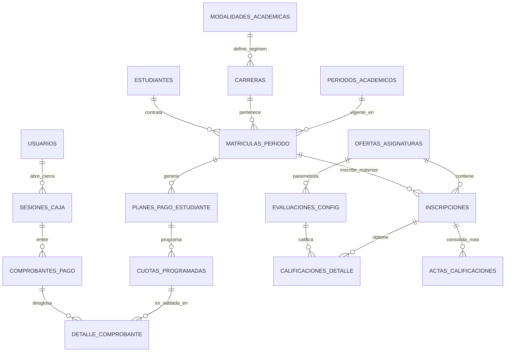

# Plan Maestro de Reestructuración de Base de Datos — SGETECBA
**Estrategia Integral para Módulos de Cajas, Cobranzas, Notas y Normalización General**

> **Aviso Importante:** Este documento es una propuesta de diseño arquitectónico. **No se han aplicado cambios aún en la base de datos ni en el código**, sirviendo como guía de decisión técnica previa para asegurar escalabilidad, integridad y cero pérdida de datos.

---

## 1. ¿Es posible y conveniente hacer la reestructuración ahora?

**Sí, es 100% posible y es el momento ideal.** 
Hacerlo en esta etapa tiene ventajas determinantes:
1. **Volumen de datos controlable:** Actualmente la base de datos cuenta principalmente con catálogos, docentes y estudiantes importados. Aún no existen cientos de miles de transacciones de dinero ni notas históricas que compliquen una migración.
2. **Evitar parches costosos a futuro:** Si se implementan los módulos de cobranzas y notas sobre la estructura actual (donde un estudiante tiene la carrera pegada a su perfil o donde no existe una matrícula semestral), en pocos meses habrá inconsistencias graves (duplicados al cambiar de carrera, cobros huérfanos, notas sin actas formales).
3. **Cero pérdida de datos:** Mediante scripts SQL de migración asistida (`ALTER`, `INSERT INTO ... SELECT`), los estudiantes, usuarios, carreras y materias ya registrados se preservan al 100%.

---

## 2. Mapa Global: ¿Qué se Mantiene, Corrige, Elimina y Crea?

```
┌────────────────────────────────────────────────────────────────────────┐
│                        MAPA DE LA BASE DE DATOS                        │
├─────────────────────┬───────────────────┬──────────────────────────────┤
│ 1. SE MANTIENEN     │ 2. SE CORRIGEN    │ 3. SE ELIMINAN / ARCHIVAN    │
│ (Catálogos base)    │ (Tablas núcleo)   │ (Tablas basura/ETL)          │
├─────────────────────┼───────────────────┼──────────────────────────────┤
│ - turnos            │ - estudiantes     │ - staging_excel_1            │
│ - grupos            │ - carreras        │ - staging_excel_2            │
│ - modalidades_acad. │ - asignaturas     │ - staging_excel_3            │
│ - generos           │ - inscripciones   │ - staging_estudiantes_unif.  │
│ - estados_asistencia│ - ofertas_asig.   │ - lotes_importacion          │
│ - motivos_abandono  │ - periodos_acad.  │ - archivos_importacion       │
│ - roles / usuarios  │ - detalle_asist.  │ - errores_importacion        │
│ - niveles_academicos│ - sesiones_asist. │ - conflictos_datos           │
│                     │                   │ - mapa_fuentes_estudiante    │
│                     │                   │ - faltas (reemplazar x vista)│
├─────────────────────┴───────────────────┴──────────────────────────────┤
│ 4. NUEVAS TABLAS A CREAR (Para Cajas, Cobranzas y Notas)               │
├─────────────────────────┬────────────────────────┬─────────────────────┤
│   MÓDULO CAJAS          │   MÓDULO COBRANZAS     │   MÓDULO NOTAS      │
├─────────────────────────┼────────────────────────┼─────────────────────┤
│ - cajas                 │ - matriculas_periodo   │ - pensum_prerreqs   │
│ - sesiones_caja         │ - conceptos_cobro      │ - evaluaciones_conf │
│ - movimientos_caja      │ - aranceles_carrera    │ - calificaciones_det│
│                         │ - planes_pago_estud.   │ - actas_calificac.  │
│                         │ - cuotas_programadas   │ - escala_calificac. │
│                         │ - comprobantes_pago    │                     │
│                         │ - detalle_comprobante  │                     │
└─────────────────────────┴────────────────────────┴─────────────────────┘
```

---

## 3. Detalle de Tablas que se MANTIENEN (Sin cambios estructurales)

Estas tablas cumplen su función a cabalidad y son catálogos sólidos:

1. **`turnos`**: (Mañana, Tarde, Noche, Sabatino). Se mantiene intacta.
2. **`grupos`**: Paralelos de aula (A, B, C...). Se mantiene intacta.
3. **`modalidades_academicas`**: (Semestral, Anual, Modular). Se mantiene intacta.
4. **`generos`**: (Masculino, Femenino, Otro). Se mantiene intacta.
5. **`estados_asistencia`**: (Presente, Falta, Licencia, Atraso). Se mantiene intacta.
6. **`motivos_abandono`**: Catálogo de causas de deserción estudiantil. Se mantiene intacta.
7. **`niveles_academicos`**: Define los semestres (1er Semestre, 2do Semestre, etc.). Solo se le añade un índice numérico para ordenamiento secuencial.

---

## 4. Detalle de Tablas que se van a ELIMINAR o ARCHIVAR

Son tablas que corresponden al proceso de migración cruda inicial desde Excel o que representan redundancia innecesaria:

| Tabla a Eliminar / Archivar | Motivo Técnico | ¿Qué se hace con sus datos? |
|---|---|---|
| **`staging_excel_1`** | Tabla temporal de carga de archivos Excel. | Ya se procesó. Se elimina o se mueve a un esquema `archivo_historico`. |
| **`staging_excel_2`** | Tabla temporal de carga secundaria. | Se elimina del esquema productivo. |
| **`staging_excel_3`** | Tabla temporal de carga terciaria. | Se elimina del esquema productivo. |
| **`staging_estudiantes_unificados`** | Tabla de apoyo usada para unificar duplicados en la migración. | Ya consolidada en `estudiantes`. Se archiva/elimina. |
| **`lotes_importacion`** | Control de subidas de Excel (0 filas activas en uso). | Se elimina para limpiar el catálogo de tablas del sistema. |
| **`archivos_importacion`** | Metadatos de archivos subidos en la migración inicial. | Se elimina. |
| **`errores_importacion`** | Logs de errores de archivos pasados. | Se elimina. |
| **`conflictos_datos`** | Registros de choques de nombres de la importación inicial. | Se elimina. |
| **`mapa_fuentes_estudiante`** | Registro de origen de filas del Excel. | Se elimina. |
| **`faltas`** | Tabla huérfana de 0 registros que duplica `detalle_asistencia`. | Se elimina. En su lugar se crea una vista SQL automática `vw_alumnos_riesgo_faltas`. |

> **Beneficio:** Se depuran **10 tablas innecesarias**, reduciendo el tamaño y la confusión en el esquema de base de datos.

---

## 5. Detalle de Tablas que se van a CORREGIR (Modificaciones Clave)

### A. Tabla `estudiantes`
* **Problema actual:**
  - `carrera_id` está dentro de `estudiantes`. Esto impide que un alumno curse 2 carreras a la vez o que si se cambia de carrera se mantenga su historial limpio.
  - `nombre_completo` está almacenado como texto fijo, arriesgando desfases si se edita el nombre o apellido.
  - `codigo_estudiante` tiene formato rígido ligado a la carrera (ej. `INF-2024-001`).
* **Correcciones:**
  1. **Retirar `carrera_id` de `estudiantes`**: La relación con la carrera se manejará en la nueva tabla `estudiantes_carreras` y en `matriculas_periodo`.
  2. **Columna `nombre_completo` calculada/generada**: En PostgreSQL se configura como columna `GENERATED ALWAYS AS (TRIM(CONCAT_WS(' ', apellido_paterno, apellido_materno, nombres))) STORED`.
  3. **Identificador único de persona:** Código estudiantil institucional inmutable (ej. `EST-001234`), independiente de la carrera.
  4. **Campos bolivianos:** Añadir `ci_expedido` (LP, CB, SC, etc.) y `ci_complemento`.

### B. Tabla `carreras`
* **Correcciones:**
  - Agregar `resolucion_ministerial VARCHAR(100)` (R.M. oficial ante el Ministerio de Educación).
  - Agregar `codigo_ministerial VARCHAR(50)`.
  - Agregar `duracion_semestres SMALLINT DEFAULT 6`.

### C. Tabla `asignaturas`
* **Correcciones:**
  - Agregar `creditos SMALLINT DEFAULT 0` (requerido para certificaciones y convalidaciones).
  - Agregar `horas_teoricas SMALLINT DEFAULT 0` y `horas_practicas SMALLINT DEFAULT 0`.
  - Agregar `es_taller BOOLEAN DEFAULT FALSE`.

### D. Tabla `periodos_academicos`
* **Correcciones:**
  - Agregar hitos de fechas: `fecha_inicio_clases`, `fecha_fin_clases`, `fecha_limite_pago_regular`, `fecha_cierre_actas_notas`.
  - Esto permitirá bloquear automáticamente el registro de notas o cobrar mora a destiempo.

### E. Tabla `inscripciones`
* **Correcciones:**
  - Actualmente asocia un estudiante directo con una materia ofertada.
  - Se vincula a una **`matricula_id`** (la matrícula de gestión semestral). De esta forma, el estudiante se matricula a la gestión/carrera y luego inscribe sus 4, 5 o 6 materias bajo esa misma matrícula.
  - Eliminar campos temporales residuales: `codigo_estudiante_origen` y `cedula_identidad_origen`.

### F. Tabla `detalle_asistencia`
* **Correcciones:**
  - Quitar la columna redundante `estudiante_id`, ya que `inscripcion_id` ya sabe exactamente qué estudiante es. Esto elimina riesgos de inconsistencia de datos.

### G. Tabla `sesiones_asistencia`
* **Correcciones:**
  - Exigir `hora_inicio` y `hora_fin` obligatorias (`NOT NULL`) para evitar duplicaciones en el mismo día.

---

## 6. Nuevas Tablas para los Módulos de Cajas, Cobranzas y Notas

### A. Módulo de Cajas (Arqueo y Control de Turnos)

Para que el dinero del instituto esté siempre cuadrado y se sepa qué cajero cobró qué:

1. **`cajas`**: Catálogo de cajas físicas o puntos de cobro.
   - `id`, `nombre` ("Caja Central", "Caja 2 Turno Noche"), `ubicacion`, `activa`.
2. **`sesiones_caja`**: Apertura y cierre de caja por usuario.
   - `id`, `caja_id`, `usuario_id` (cajero), `fecha_apertura`, `monto_inicial` (saldo base para cambio), `fecha_cierre`, `monto_esperado` (calculado por el sistema), `monto_declarado` (lo que el cajero cuenta en efectivo), `diferencia` (sobrante o faltante), `estado` ('ABIERTA', 'CERRADA', 'ARQUEADA'), `observaciones`.
3. **`movimientos_caja`**: Para ingresos y egresos menores de caja chica no estudiantiles.
   - `id`, `sesion_caja_id`, `tipo` ('INGRESO', 'EGRESO'), `concepto`, `monto`, `comprobante_respaldo`, `creado_en`.

---

### B. Módulo de Cobranzas (Matrícula, Cuotas, Becas y Recibos)

Este módulo garantiza que el instituto tenga control exacto de deudas, planes de pago y cobros:

```
                      ┌──────────────────────┐
                      │  matriculas_periodo  │
                      └──────────┬───────────┘
                                 │
                     ┌───────────▼───────────┐
                     │ planes_pago_estudiante│
                     └───────────┬───────────┘
                                 │
                     ┌───────────▼───────────┐
                     │   cuotas_programadas  │
                     └───────────┬───────────┘
                                 │
                ┌────────────────┴───────────────┐
                ▼                                ▼
     ┌──────────────────────┐       ┌──────────────────────┐
     │   detalle_pago       │◄──────┤  comprobantes_pago   │
     └──────────────────────┘       │  (Recibo / Factura)  │
                                    └──────────▲───────────┘
                                               │
                                    ┌──────────┴───────────┐
                                    │    sesiones_caja     │
                                    └──────────────────────┘
```

1. **`matriculas_periodo`**: El contrato académico y financiero del estudiante con el periodo actual.
   - `id`, `estudiante_id`, `carrera_id`, `periodo_id`, `turno_id`, `fecha_matricula`, `estado` ('REGULAR', 'CONDICIONAL', 'RETIRADO').
2. **`conceptos_cobro`**: Catálogo de servicios cobrables.
   - `id`, `codigo` ('MAT', 'CUOTA_MENSUAL', 'CERT_NOTAS', 'TITULACION', 'MORA'), `nombre`, `es_obligatorio`, `permite_descuento`.
3. **`aranceles_carrera`**: Precios oficiales según carrera, turno y periodo.
   - `id`, `carrera_id`, `periodo_id`, `concepto_id`, `monto_base` (ej. Matrícula 200 Bs, Mensualidad 450 Bs).
4. **`planes_pago_estudiante`**: Configuración de pago de cada estudiante.
   - `id`, `matricula_id`, `modalidad_pago` ('CONTADO', '5_CUOTAS', 'POR_MATERIA'), `porcentaje_beca` (0% a 100%), `tipo_beca` ('NINGUNA', 'EXCELENCIA', 'CONVENIO', 'TRABAJO'), `motivo_beca`, `monto_total_acordado`.
5. **`cuotas_programadas`**: Cada una de las mensualidades calendarizadas.
   - `id`, `plan_pago_id`, `numero_cuota` (1, 2, 3, 4, 5...), `concepto_id`, `fecha_vencimiento`, `monto_original`, `monto_descuento`, `monto_mora`, `monto_total`, `saldo_pendiente`, `estado` ('PENDIENTE', 'PAGADA', 'MORA', 'ANULADA').
6. **`comprobantes_pago`**: El recibo oficial emitido al cobrar.
   - `id`, `numero_comprobante` (correlativo único oficial: ej. `REC-2026-000142`), `sesion_caja_id`, `estudiante_id`, `fecha_pago`, `monto_total_pagado`, `metodo_pago` ('EFECTIVO', 'QR', 'TRANSFERENCIA', 'MIXTO'), `codigo_transaccion` (para pagos QR o banco), `cajero_id`, `observaciones`, `estado` ('EMITIDO', 'ANULADO').
7. **`detalle_comprobante`**: El desglose de qué cuotas o ítems salda este recibo.
   - `id`, `comprobante_id`, `cuota_id` (NULL si es cobro suelto de certificado), `concepto_id`, `monto_aplicado`.

---

### C. Módulo de Notas y Rendimiento Académico (Soporte Anual, Semestral y Modular)

El instituto TECBA opera bajo **3 modalidades académicas distintas**, por lo que el motor de calificaciones y notas no puede ser rígido; debe adaptarse dinámicamente según el régimen de la carrera o materia:

```
┌──────────────────────────────────────────────────────────────────────────────────┐
│              SOPORTE PARA LAS 3 MODALIDADES ACADÉMICAS EN TECBA                  │
├──────────────────────┬─────────────────────────────┬─────────────────────────────┤
│ 1. RÉGIMEN ANUAL     │ 2. RÉGIMEN SEMESTRAL        │ 3. RÉGIMEN MODULAR          │
├──────────────────────┼─────────────────────────────┼─────────────────────────────┤
│ - Duración: 10 meses │ - Duración: 5 meses         │ - Duración: 3 a 5 semanas   │
│ - Evaluaciones:      │ - Evaluaciones:             │ - Evaluaciones:             │
│   4 Bimestres o      │   1er Parcial (25-35%)      │   Evaluación Continua (40%) │
│   3 Trimestres       │   2do Parcial (25-35%)      │   Prácticas/Talleres (30%)  │
│   + Examen Final     │   Prácticas/Aula (15-20%)   │   Proyecto/Examen Final(30%)│
│ - Cobranzas:         │   + Examen Final (20-30%)   │ - Cobranzas:                │
│   10 cuotas anuales  │ - Cobranzas:                │   Cobro por módulo unitario │
│                      │   5 cuotas por semestre     │   o plan modular            │
└──────────────────────┴─────────────────────────────┴─────────────────────────────┘
```

#### Tablas del Módulo Académico y Calificaciones:

1. **`reglas_evaluacion_modalidad`**:
   - Parametriza las fórmulas de cálculo por modalidad (`modalidad_id`: Anual, Semestral, Modular).
   - `id`, `carrera_id`, `modalidad_id`, `nombre_esquema` (ej. "Semestral Estándar 100 pts", "Modular Práctico", "Anual 4 Bimestres"), `nota_minima_aprobacion` (ej. 51 o 61 pts), `permite_segundo_turno` (TRUE/FALSE).
2. **`pensum_prerrequisitos`**: Correlatividades de asignaturas.
   - `id`, `pensum_id` (materia actual), `prerrequisito_pensum_id` (materia que debe aprobar antes).
   - *Ejemplo: Para cursar "Programación II", debe tener aprobada "Programación I".*
3. **`evaluaciones_config`**: Las ponderaciones que aplican a la materia ofertada según su modalidad.
   - `id`, `oferta_id`, `periodo_evaluacion` ('1ER_PARCIAL', '2DO_PARCIAL', 'BIMESTRE_1', 'MODULO_FINAL', etc.), `nombre_evaluacion`, `porcentaje_peso` (ej. 25%, 35%), `nota_maxima` (100).
4. **`calificaciones_detalle`**: La nota que sacó el estudiante en cada evaluación específica.
   - `id`, `evaluacion_config_id`, `inscripcion_id`, `nota_obtenida` (0.00 a 100.00), `observaciones`, `modificado_por`, `fecha_registro`.
5. **`actas_calificaciones`**: El documento final oficial que consolida la nota final calculada automáticamente.
   - `id`, `oferta_id`, `inscripcion_id`, `nota_final` (0 a 100 calculada según la fórmula de la modalidad), `nota_segundo_turno`, `estado_materia` ('APROBADO', 'REPROBADO', 'ABANDONO', 'SEGUNDO_TURNO'), `fecha_cierre`, `cerrado_por_docente_id`, `es_definitiva` (TRUE para bloquear posteriores modificaciones).

---

## 7. Diagrama Relacional Completo del Nuevo Ecosistema



---

## 8. Hoja de Ruta Estratégica: El Orden Correcto de Construcción

Tal como indicas, el desarrollo debe seguir un orden riguroso y en fases para no romper lo que ya funciona:

```
┌────────────────────────────────────────────────────────────────────────┐
│                   ORDEN SECUENCIAL DE DESARROLLO                       │
├────────────────────────────────────────────────────────────────────────┤
│ FASE 1: BASE DE DATOS (Fundación)                                      │
│  1. Respaldo total de PostgreSQL (Dump de seguridad).                  │
│  2. Limpieza de tablas residuales (10 tablas ETL/staging eliminadas).  │
│  3. Normalización de tablas núcleo (Estudiantes, Inscripciones, etc.). │
│  4. Creación de nuevas tablas (Cajas, Cobranzas, Notas tri-modal).     │
│  5. Migración de los datos actuales hacia la nueva estructura.         │
├────────────────────────────────────────────────────────────────────────┤
│ FASE 2: ESTABILIZACIÓN DE LO ACTUAL (Ajuste Back & Front)              │
│  1. Adaptar endpoints del backend (FastAPI) a los nuevos esquemas.     │
│  2. Sincronizar el frontend (React) para que autenticación, carreras,  │
│     asignaturas, docentes y asistencias sigan funcionando perfecto.    │
│  3. Validar que la navegación y datos no tengan ningún fallo.          │
├────────────────────────────────────────────────────────────────────────┤
│ FASE 3: IMPLEMENTACIÓN DE LOS NUEVOS MÓDULOS (Paso a Paso)             │
│  Etapa 3.1: Módulo Integral de Estudiantes                             │
│             - Ficha completa, inscripción a 1 o 2 carreras, legajo.    │
│  Etapa 3.2: Módulo de Cajas & Cobranzas                                │
│             - Apertura/cierre de caja, registro de pagos por cuota     │
│               (efectivo/QR), planes de pago, emisión de comprobantes.  │
│  Etapa 3.3: Módulo de Notas & Docentes                                 │
│             - Interfaz docente para carga de notas según modalidad     │
│               (Anual, Semestral o Modular), cálculo automático de      │
│               promedios y actas oficiales de notas.                    │
└────────────────────────────────────────────────────────────────────────┘
```

---

## 9. Resumen de Decisiones para tu Aprobación

| Aspecto | Propuesta de Reestructuración |
|---|---|
| **¿Riesgo de pérdida de alumnos o datos?** | **Cero**. Se respaldan con dump previo y se migran con scripts SQL verificados. |
| **¿Soporte de Modalidades?** | **Completo**. Diseñado para calcular notas y cobrar cuotas tanto en régimen **Anual**, **Semestral** como **Modular**. |
| **¿Tablas a eliminar?** | 10 tablas temporales/inactivas de importación Excel que hoy solo estorban. |
| **¿Módulo de Cajas?** | Listo para apertura de caja, control de efectivo/QR y arqueo diario con sobrante/faltante. |
| **¿Módulo de Cobranzas?** | Listo para cuotas mensuales, becas, moras, cobro rápido y generación de recibos PDF. |
| **¿Módulo de Notas?** | Listo para notas parciales, bimestrales o continuas según modalidad, con actas oficiales. |
| **¿Estado actual?** | **Solo en documento MD de planificación.** No se ha ejecutado ninguna alteración en el código ni en la base de datos. |

